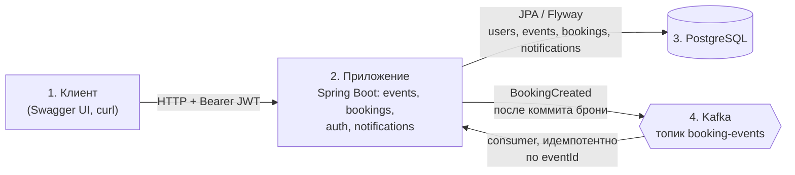

# eventsbooking

[](https://github.com/AnKukl/eventsbooking/actions/workflows/ci.yml)

REST API для мероприятий и бронирования мест: Spring Boot 4, Java 25, PostgreSQL, Kafka, JWT.
Правила разработки и команды — [CLAUDE.md](CLAUDE.md), архитектурные решения — [docs/decisions.md](docs/decisions.md).

## Запуск одной командой

```
# PowerShell: секрет на сессию (минимум 32 байта), без него compose не стартует
$env:JWT_SECRET = [Convert]::ToBase64String((1..48 | ForEach-Object { Get-Random -Maximum 256 }) -as [byte[]])
docker compose up -d --build
curl.exe http://localhost:8080/actuator/health
```

Поднимаются `postgres`, `kafka` и `app` (многоэтапный [Dockerfile](Dockerfile): сборка на `eclipse-temurin:25-jdk`,
запуск на `eclipse-temurin:25-jre` под непривилегированным пользователем). Если порт 8080 занят: `$env:APP_PORT = "8083"`.
Секреты в образ не попадают: `JWT_SECRET` и пароль БД передаются только переменными окружения при запуске.
Любая команда `docker compose` (в том числе `down`) требует заданный `JWT_SECRET`. Остановить: `docker compose down`
(данные БД сохраняются), `docker compose down -v` (с удалением данных).

Приложение на хосте (без контейнера для `app`):

```
docker compose up -d postgres kafka
$env:JWT_SECRET = "..."
.\mvnw.cmd spring-boot:run
```

Тесты и сборка: `.\mvnw.cmd verify` (нужен Docker: Testcontainers поднимает PostgreSQL и Kafka).

## OpenAPI и Swagger UI

После запуска (порт 8080 по умолчанию):

- Swagger UI: <http://localhost:8080/swagger-ui.html>
- OpenAPI JSON: <http://localhost:8080/v3/api-docs>

Документация открыта без токена. Чтобы пробовать защищённые методы, получите токен через `POST /api/auth/login`
и нажмите **Authorize** в Swagger UI.

## Схема



1. **Клиент** ходит в API с JWT, полученным при логине.
2. **Приложение** — один Spring Boot сервис: мероприятия, бронирование (оптимистическая блокировка), аутентификация,
   consumer уведомлений.
3. **PostgreSQL** хранит всё состояние; схема меняется только миграциями Flyway.
4. **Kafka** передаёт `BookingCreated`; consumer пишет уведомление в `notifications` и не создаёт дублей.

## Эндпоинты

| Метод | Путь | Доступ | Описание |
|---|---|---|---|
| POST | `/api/auth/register` | открыт | регистрация; всегда `USER`, а с верным `inviteCode` (`ORGANIZER_INVITE_CODE`) — `ORGANIZER` |
| POST | `/api/auth/login` | открыт | вход, возвращает JWT |
| GET | `/api/me` | любой пользователь с токеном | текущий пользователь (id, email, роль) |
| GET | `/api/events?page=0&size=10` | открыт (гость и пользователь) | список мероприятий с пагинацией; поля `seatStatus` (`AVAILABLE`/`SOLD_OUT`) и `isFavorite` (для гостя `false`) |
| GET | `/api/events/{id}` | открыт (гость и пользователь) | одно мероприятие, те же поля |
| POST | `/api/events` | `ORGANIZER` | создать мероприятие (организатор = текущий пользователь) |
| PUT | `/api/events/{id}` | `ORGANIZER`, только автор | изменить мероприятие |
| DELETE | `/api/events/{id}` | `ORGANIZER`, только автор | удалить мероприятие |
| POST | `/api/events/{eventId}/bookings` | любой пользователь с токеном | забронировать место для текущего пользователя, тело не нужно (`409`: мест нет, бронь уже есть, событие началось) |
| POST | `/api/events/{eventId}/bookings/{bookingId}/cancel` | любой пользователь с токеном | отменить свою бронь не позже чем за 24 часа до начала (чужая даёт `404`) |
| GET | `/api/bookings/my?page=0&size=20` | любой пользователь с токеном | мои брони, новые сверху |
| POST | `/api/favorites/{eventId}` | любой пользователь с токеном | добавить в избранное: `201` создано, `200` уже было, `404` нет такого события |
| DELETE | `/api/favorites/{eventId}` | любой пользователь с токеном | убрать из избранного: всегда `204`, повтор безопасен |
| GET | `/api/favorites?page=0&size=20` | любой пользователь с токеном | мои избранные события (новые сверху, с `seatStatus`), чужих не видно |
| GET | `/actuator/health` | открыт | состояние приложения |
| GET | `/v3/api-docs`, `/swagger-ui.html` | открыт | OpenAPI и Swagger UI |

Ошибки — `application/problem+json` (RFC 9457): 400 (валидация, со списком полей), 401, 403, 404, 409. `503` с `Retry-After`, если недоступна база данных.

**Для браузерного клиента:** CORS разрешён для origin из `CORS_ALLOWED_ORIGINS` (по умолчанию `http://localhost:5173` и `http://localhost:3000`), токен передаётся заголовком `Authorization: Bearer ...`. Организаторов регистрирует тот, кто знает `ORGANIZER_INVITE_CODE`: задайте его переменной окружения перед `docker compose up` (`$env:ORGANIZER_INVITE_CODE = "..."`), иначе роль `ORGANIZER` недоступна.

## Следующий шаг: dead letter topic

Сейчас сообщение, которое не удалось обработать после 3 повторов (или нечитаемое), логируется и пропускается —
уведомление теряется. Следующий шаг — dead letter topic `booking-events.DLT`:

1. Заменить пропуск на `DeadLetterPublishingRecoverer` в `DefaultErrorHandler`: проблемная запись уходит в
   `booking-events.DLT` вместе с причиной ошибки в заголовках.
2. Алерт на рост `booking-events.DLT`.
3. Инструмент или эндпоинт для повторной отправки записей из DLT после исправления причины.
4. Для потери события между коммитом брони и отправкой — transactional outbox (см. decisions.md, запись 006).
