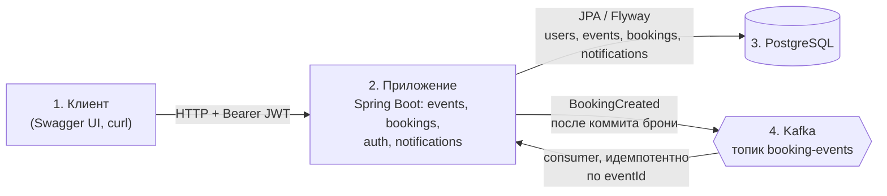

# eventsbooking

[](https://github.com/AnKukl/eventsbooking/actions/workflows/ci.yml)

REST API для мероприятий и бронирования мест: Spring Boot 4, Java 25, PostgreSQL, Kafka, JWT.
Правила разработки и команды — [CLAUDE.md](CLAUDE.md), архитектурные решения — [docs/decisions.md](docs/decisions.md).

## Запуск одной командой

```
# PowerShell: секрет на сессию (минимум 32 байта), без него compose не стартует
$env:JWT_SECRET = [Convert]::ToBase64String((1..48 | ForEach-Object { Get-Random -Maximum 256 }) -as [byte[]])
docker compose up -d --build
curl.exe http://localhost:8080/actuator/health
```

Поднимаются `postgres`, `kafka` и `app` (многоэтапный [Dockerfile](Dockerfile): сборка на `eclipse-temurin:25-jdk`,
запуск на `eclipse-temurin:25-jre` под непривилегированным пользователем). Если порт 8080 занят: `$env:APP_PORT = "8083"`.
Секреты в образ не попадают: `JWT_SECRET` и пароль БД передаются только переменными окружения при запуске.
Любая команда `docker compose` (в том числе `down`) требует заданный `JWT_SECRET`. Остановить: `docker compose down`
(данные БД сохраняются), `docker compose down -v` (с удалением данных).

Приложение на хосте (без контейнера для `app`):

```
docker compose up -d postgres kafka
$env:JWT_SECRET = "..."
.\mvnw.cmd spring-boot:run
```

Тесты и сборка: `.\mvnw.cmd verify` (нужен Docker: Testcontainers поднимает PostgreSQL и Kafka).

## OpenAPI и Swagger UI

После запуска (порт 8080 по умолчанию):

- Swagger UI: <http://localhost:8080/swagger-ui.html>
- OpenAPI JSON: <http://localhost:8080/v3/api-docs>

Документация открыта без токена (кроме профиля `prod`). Чтобы пробовать защищённые методы, выполните
`POST /api/auth/login` прямо в Swagger UI: браузер получит cookie сессии и будет отправлять её сам.

## Схема



1. **Клиент** ходит в API с JWT, полученным при логине.
2. **Приложение** — один Spring Boot сервис: мероприятия, бронирование (оптимистическая блокировка), аутентификация,
   consumer уведомлений.
3. **PostgreSQL** хранит всё состояние; схема меняется только миграциями Flyway.
4. **Kafka** передаёт `BookingCreated`; consumer пишет уведомление в `notifications` и не создаёт дублей.

## Эндпоинты

| Метод | Путь | Доступ | Описание |
|---|---|---|---|
| POST | `/api/auth/register` | открыт | регистрация; всегда `USER`, а с верным `inviteCode` (`ORGANIZER_INVITE_CODE`) — `ORGANIZER`. 10 в минуту с адреса и на email |
| POST | `/api/auth/login` | открыт | вход: ставит cookie `access_token` (15 минут) и `refresh_token` (14 дней, только `/api/auth`), обе HttpOnly; в теле только `{"expiresIn": ...}`. Не больше 10 попыток в минуту с адреса и на email (`429` + `Retry-After`) |
| POST | `/api/auth/refresh` | cookie `refresh_token` | новая пара cookie (ротация); отозванный или истёкший токен — `401` и очистка cookie. 10 в минуту с адреса |
| POST | `/api/auth/logout` | открыт | `204`, отзывает refresh-токен и стирает обе cookie |
| GET | `/api/me` | любой пользователь с токеном | текущий пользователь: id, email, роль, имя, телефон, язык, город, `emailVerified` |
| PATCH | `/api/me` | любой пользователь с токеном | изменить `name`, `phone` (`+48123456789`), `language` (`RU`/`PL`/`EN`), `city`; не переданное не меняется, пустая строка очищает; email здесь не меняется |
| POST | `/api/me/email-change` | любой пользователь с токеном | сменить email: `{"newEmail": "..."}`, `202`; адрес меняется после подтверждения; не чаще раза в минуту (`429` + `Retry-After`) |
| POST | `/api/auth/confirm-email` | открыт | подтвердить смену email: `{"token": "..."}`, `204`; токен живёт 24 часа и одноразовый, иначе `400` |
| GET, PUT | `/api/me/notifications/preferences` | любой пользователь с токеном | каналы (`email`, `push`) для каждого типа уведомлений; по умолчанию всё включено |
| GET | `/api/events?page=0&size=10` | открыт (гость и пользователь) | список мероприятий с пагинацией; поля `seatStatus` (`AVAILABLE`/`SOLD_OUT`) и `isFavorite` (для гостя `false`) |
| GET | `/api/events/{id}` | открыт (гость и пользователь) | одно мероприятие, те же поля |
| GET | `/api/organizer/events?status=DRAFT\|PUBLISHED\|SOLD_OUT\|CANCELLED&page=0&size=20` | `ORGANIZER` | мои события с пагинацией и фильтром по статусу |
| GET | `/api/organizer/events/{id}` | `ORGANIZER`, только автор | событие со всеми полями и `version` |
| POST | `/api/organizer/events` | `ORGANIZER` | создать черновик: обязательны `title`, `startsAt`, `capacity`; необязательны `description`, `shortDescription`, `venue`, `price`, `waitlistEnabled`, `audienceFit`, `audienceNotFit` |
| PATCH | `/api/organizer/events/{id}` | `ORGANIZER`, только автор | частичное изменение; обязателен `version` из последнего ответа (устаревший — `409`; брони версию не меняют) |
| PUT | `/api/organizer/events/{id}/publish` | `ORGANIZER`, только автор | опубликовать: нужны название, будущая дата, `venue`, `price`, минимум одно фото; иначе `422` и список `errors` с незаполненными полями |
| POST | `/api/organizer/events/{id}/media` | `ORGANIZER`, только автор | загрузка фото, `multipart/form-data`, поле `files` (можно несколько); всего до 6 на событие, JPG/PNG/WebP до 8 МБ, тип проверяется по содержимому (`415` для подмены расширения, `413` для большого файла) |
| GET | `/api/organizer/events/{id}/bookings?page=0&size=20` | `ORGANIZER`, только автор | брони события без email и телефона (участник: `id` и имя) |
| GET | `/api/organizer/analytics?range=7d` | `ORGANIZER` | продано, выручка и заполненность за `1d`–`365d` (считается SQL-запросом) |
| GET | `/api/media/{имя}` | открыт | загруженное фото (имя из ответа загрузки), кэшируется на год |
| GET | `/api/events/{id}/preview` | открыт (гость и пользователь) | данные предпросмотра: `shortDescription`, `audienceFit`, `audienceNotFit`, `media`; `Cache-Control: max-age=300`, `ETag`, `304` по `If-None-Match` |
| POST | `/api/events` | `ORGANIZER` | создать мероприятие (организатор = текущий пользователь); необязательные поля предпросмотра: `shortDescription` (≤160), `audienceFit` (≤4 строк по ≤100), `audienceNotFit` (≤3), `media` (≤6 картинок `{url, alt}`, первая — обложка, только `http(s)`) |
| PUT | `/api/events/{id}` | `ORGANIZER`, только автор | изменить мероприятие; поля предпросмотра, которых нет в теле, не меняются, пустой список очищает |
| DELETE | `/api/events/{id}` | `ORGANIZER`, только автор | удалить мероприятие |
| POST | `/api/bookings` | любой пользователь с токеном | удержать места: `{"eventId": 5, "seats": 2}` (`seats` по умолчанию 1, не больше `app.booking.max-seats-per-booking` = 4, иначе `400`). Бронь получает статус `HOLD` на 10 минут. Заголовок `Idempotency-Key` (необязательный, до 100 символов `A-Za-z0-9._:-`): повтор того же запроса возвращает ту же бронь (`200` и `Idempotent-Replayed: true`, первый раз `201`); тот же ключ с другим запросом — `409`. `409` также: мест нет, бронь уже есть, событие началось |
| POST | `/api/bookings/{id}/confirm` | владелец брони | `HOLD` → `CONFIRMED` до истечения удержания (позже — `409`); так будет вызываться после успешной оплаты |
| POST | `/api/bookings/{id}/cancel` | владелец брони | отмена, тело `{"reason": "CHANGED_PLANS"\|"SCHEDULE_CONFLICT"\|"FOUND_ALTERNATIVE"\|"TOO_EXPENSIVE"\|"OTHER"}`. Подтверждённая бронь за 24 часа и более до начала → `REFUND_PENDING` и запрос возврата (`PaymentGateway.refund`, пока заглушка); позже, а также отмена `HOLD` — просто `CANCELLED` без возврата. Повторная отмена — `409`, чужая бронь — `404` |
| GET | `/api/bookings/my?page=0&size=20` | любой пользователь с токеном | мои брони (все статусы), новые сверху |
| POST | `/api/favorites/{eventId}` | любой пользователь с токеном | добавить в избранное: `201` создано, `200` уже было, `404` нет такого события |
| DELETE | `/api/favorites/{eventId}` | любой пользователь с токеном | убрать из избранного: всегда `204`, повтор безопасен |
| GET | `/api/favorites?page=0&size=20` | любой пользователь с токеном | мои избранные события (новые сверху, с `seatStatus`), чужих не видно |
| POST | `/api/events/{eventId}/waitlist` | любой пользователь с токеном | встать в очередь на заполненное событие, тело `{"channel": "EMAIL"\|"PUSH"}`: `201` создано, `200` уже в очереди, `409` есть места / событие началось / уже есть бронь. Когда место освобождается (отмена брони или рост `capacity`), уведомляется первый в очереди |
| GET | `/api/me/notifications?page=0&size=20` | любой пользователь с токеном | лента уведомлений (брони и «место освободилось»), новые сверху |
| GET | `/actuator/health` | открыт | состояние приложения |
| GET | `/v3/api-docs`, `/swagger-ui.html` | открыт | OpenAPI и Swagger UI |

Ошибки — `application/problem+json` (RFC 9457, схема `ProblemDetail` в OpenAPI): 400 (валидация, со списком полей), 401,
403, 404, 409, 422, 429. `503` с `Retry-After`, если недоступна база данных. Приватные ответы под `/api` идут с
`Cache-Control: no-store`. Контракт API зафиксирован в [docs/openapi.json](docs/openapi.json) (тест `OpenApiSnapshotTest`
падает при расхождении); в профиле `prod` Swagger UI и `/v3/api-docs` выключены.

**Для браузерного клиента:** сессия — HttpOnly cookie, токен в JavaScript не попадает (решение 017). Запросы с cookie
и методом `POST/PUT/PATCH/DELETE` принимаются только с `Origin` из `CORS_ALLOWED_ORIGINS` (по умолчанию
`http://localhost:5173` и `http://localhost:3000`) или с origin самого API, иначе `403`. CORS разрешает credentials
только для этого списка. Cookie по умолчанию `Secure`. На `http://localhost` браузеры принимают их и так; для http на другом хосте задайте
`APP_SECURITY_COOKIE_SECURE=false`. Swagger UI после `POST /api/auth/login` работает через cookie; скрипты могут
по-прежнему слать `Authorization: Bearer ...`. Организаторов регистрирует тот, кто знает `ORGANIZER_INVITE_CODE`: задайте его переменной
окружения перед `docker compose up` (`$env:ORGANIZER_INVITE_CODE = "..."`), иначе роль `ORGANIZER` недоступна.

## Следующий шаг: dead letter topic

Сейчас сообщение, которое не удалось обработать после 3 повторов (или нечитаемое), логируется и пропускается —
уведомление теряется. Следующий шаг — dead letter topic `booking-events.DLT`:

1. Заменить пропуск на `DeadLetterPublishingRecoverer` в `DefaultErrorHandler`: проблемная запись уходит в
   `booking-events.DLT` вместе с причиной ошибки в заголовках.
2. Алерт на рост `booking-events.DLT`.
3. Инструмент или эндпоинт для повторной отправки записей из DLT после исправления причины.
4. Для потери события между коммитом брони и отправкой — transactional outbox (см. decisions.md, запись 006).
